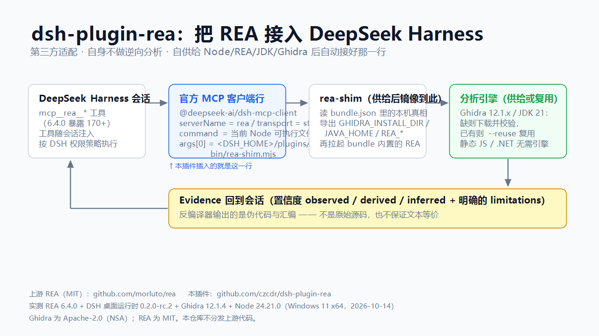

# dsh-plugin-rea

[](https://www.npmjs.com/package/dsh-plugin-rea)

[English](README.md) · **简体中文**

> **这是哪个版本？2.x —— 而 `main` 就是它。** 2.x 自己准备运行时（Node、REA CLI、JDK、Ghidra）再把那一行接好：
> 装插件 → 跑一次 `scripts/setup.mjs` → 重启 dsh。
> **1.x** 是更早的纯配置适配器 —— 它假设 `rea` 在 PATH 上、Ghidra 由你自己装好 —— 保留在
> [`v1` 分支](https://github.com/czcdr/dsh-plugin-rea/tree/v1)，npm 上仍是 `dsh-plugin-rea@1.0.6`。
> 完整对比：[两条线：1.x 与 2.x](#两条线1x-与-2x) · 升级：[从 1.x 升级](#从-1x-升级)。

把上游 **[REA — Reverse Engineer Anything](https://github.com/morluto/rea)** 的 MCP 服务接入
**DeepSeek Harness**（dsh），让它的工具在会话里以 `mcp__rea__*` 出现。



## 这是什么

一个**带供给层的 Cordis bundle**。`package.json` 声明 `dsh.bundle.patch`，该 patch 插入一行官方 MCP 客户端
插件（`@deepseek-ai/dsh-mcp-client`）。这一行用当前运行的 Node 可执行文件启动 `bin/rea-shim.mjs`，由 shim
读取 `scripts/setup.mjs` 写下的本机状态，再拉起它供给的 REA CLI。这里没有任何分析代码，且**发布出去的
patch 里不含任何机器路径**。

> **第三方适配。** 本仓库不属于 REA，不携带 REA 的任何代码，也不由 REA 作者维护；它只组装一行配置，
> 并从上游官方源拉取上游自己的发布物。
> 上游：[github.com/morluto/rea](https://github.com/morluto/rea)（MIT）·
> [中文文档](https://github.com/morluto/rea/blob/main/README_zh.md#可以分析什么) ·
> [rea.tools](https://rea.tools/) · npm 包 `rea-agents`。
> REA 自身的问题请提给上游；**本插件**的问题提到
> [本仓库 issues](https://github.com/czcdr/dsh-plugin-rea/issues)。

**它只做三件事**：注册 `mcp__rea__*` 这批工具名；把每台机器各自的引擎环境
（`GHIDRA_INSTALL_DIR`、`JAVA_HOME`、`REA_ADB_PATH`、`REA_APKTOOL_COMMAND`、`REA_JADX_MCP_JAR`、
`REA_BROWSER_EXECUTABLE` 等）限定在那一个 MCP 子进程上、而不是整个 harness；以及把这些组件装到盘上。

## 能做什么、不能做什么

分析能力属上游，本节只是复述上游自己的契约，避免预期错位。

- **它无法还原完整源码。** 原生二进制上游给的是*伪代码与汇编*，APK 是*反编译方法*，JEB 单元是*伪代码*，
  JavaScript/Electron 是*模块及其关系*。上游的工具契约明确写着伪代码"是反编译器输出，不是原始源码，
  也不与另一 provider 的输出文本等价"。
- 实际上拿不回来的：原始标识符名、类型、注释、宏与模板展开、构建脚本与资源。优化（内联、重排）、
  符号剥离、混淆、加壳、VM 保护只会让输出更差。
- 每个结果都带**置信度与限制**（`observed` / `derived` / `inferred`，外加一份明确的 limitations 列表）。
  请当证据读，别当还原出来的源码。
- 适合：理解行为、定位实现、互操作与兼容重写、安全审阅、迁移参考。要拿真正的源码，走正规渠道 ——
  上游仓库、厂商授权，或厂商自己的 SDK。

**供给解决不了的部分。** 这些是上游的宿主门槛，不是本插件漏配了什么：

| 能力 | 门槛 |
|---|---|
| Hopper provider | 仅 macOS |
| IDA provider | 需要你自己的 IDA 与 `REA_IDA_MCP_CONFIG`；REA 从不启动 IDA |
| 固件 `binwalk` / `unblob` | 仅 Linux |
| Wakaru JS 还原、pwntools 的 ELF/宕机转储路径 | 仅 Linux x64 |
| pwndbg / gdb 核心上下文 | 仅 Linux、macOS |
| 原生 mitmproxy 抓包 | 仅 Linux（`REA_MITMDUMP_COMMAND`）；HAR 不需要引擎 |
| 苹果工具链（Mach-O、plist、资源目录、LLDB） | 仅 macOS |
| `capture_process_scenario` | 仅 Linux/macOS 的 PTY |
| apktool（Android 资源解码） | 仅当 `REA_APKTOOL_COMMAND` 指向 Node 能**直接执行**的文件时才可用：上游用 `execFile` 不加 shell 直接起这个命令，而 Windows 上 Node 无法直接执行 `.bat`/`.cmd`（EINVAL）。本包按上游文档接的是官方 `apktool.bat`，所以在 Windows 上它拿不到版本、该能力不可用；JADX 走 jar，不受影响 |

## 两条线：1.x 与 2.x

| | **2.x** —— 当前这条，`main` | **1.x** —— [`v1`](https://github.com/czcdr/dsh-plugin-rea/tree/v1) |
|---|---|---|
| 是什么 | 适配器**加供给**：自己准备 Node、REA CLI、JDK、Ghidra，再把那一行接好 | 纯配置适配器：一行 MCP 行，指向你自己装好的 `rea` |
| 前置 | 运行时什么都不用装 —— 缺什么它去取（`--reuse` 则复用机器上已有的 Ghidra/JDK） | Node.js（满足 REA engines）、`npm i -g rea-agents`，原生分析还要 Ghidra 12.1.x |
| 首次运行 | 先跑一次 `scripts/setup.mjs`（或引导脚本），再重启 dsh | 不用跑任何东西 |
| 那一行启动什么 | 当前 Node 可执行文件 + `<DSH_HOME>/plugins/rea-bundle/bin/rea-shim.mjs`（由 shim 读本机状态） | Windows 上 `cmd.exe /c rea mcp`，macOS/Linux 上 `rea mcp` |
| 机器状态 | `<DSH_HOME>/plugins/rea-bundle/` —— `bundle.json`、`vendor/`、`cache/` | 你自己的 REA 与 Ghidra 安装 |
| 安装 | `dsh plugin --profile <profile> add dsh-plugin-rea`（npm `latest` ≥ 2.0.0） | `… add dsh-plugin-rea@1.0.6`，或 `github:czcdr/dsh-plugin-rea#v1.0.6` |

两条线发布的是**同一种 patch 形态**（一条 `insert` 行，`@deepseek-ai/dsh-mcp-client`），对外也提供同一套
`mcp__rea__*` 工具面；区别只在"谁准备运行时"。从 1.x 到 2.x 只要两条命令，见
[从 1.x 升级](#从-1x-升级)。

上游现在也能自己注册进 dsh（`rea setup --client dsh`）：那基本就是上游维护的 1.x 模式 —— 只写配置，
Node/REA/Ghidra 由你准备。本包是零依赖路线。三条路选一条，不要同时留两行 `serverName: rea`。

## 安装

**前置什么都不用装。** 在干净的 Windows x64 机器上：

```
powershell -ExecutionPolicy Bypass -File scripts\rea-bundle-bootstrap.ps1 -Reuse
```

`-Reuse` 会复用你已有的 Ghidra/JDK；去掉它则从官方发布下载两者（约 775 MB，逐个校验和验证）。然后为你的
profile 安装插件：

```
dsh plugin --profile <profile> add dsh-plugin-rea
# 或钉住这个版本，而不是跟着 npm latest 走：
dsh plugin --profile <profile> add github:czcdr/dsh-plugin-rea#v2.0.8
```

> **Electron 宿主（DeepSeek Harness 桌面版）的 profile 由应用独占。** 那种机器上 `dsh plugin --profile desktop …`
> 会被 CLI 直接拒绝（`profile "desktop" is managed exclusively by the Electron application`），请改用**应用内的
> 插件管理器**安装/更新；上面这条 CLI 只适用于你自己用 CLI 建的非 `desktop` profile。

如果机器上已经有 Node，可以跳过引导脚本直接供给：

```
node scripts/setup.mjs --reuse      # 或先 --dry-run 看计划
```

如果 Node 由你自备（而不是让 setup 去取），它必须满足 REA 的 engines：
`^22.19.0 || ^24.11.0 || >=26.0.0`（用 `node -v` 核对）。版本偏低不会在安装时失败，而是到 MCP 行
启动时才失败 —— 表现就是"没有反应"。

反过来**先装插件**也可以，但要分两步：发布的行指向 `<DSH_HOME>/plugins/rea-bundle/bin/rea-shim.mjs`，
而那个文件**只有 setup 会创建**——所以在第一次供给之前，该行会以 `MODULE_NOT_FOUND` 退出，也就没有
任何东西能去启动后台供给（harness 本身不受影响：`failOnStartupError: false` 是刻意的）。先手动跑一次
`node scripts/setup.mjs`；此后 shim 就位，之后每一次「状态缺失」都由它自己发现并在后台补供给。

### 支持哪些 DSH 版本

`package.json` 里声明了 `engines.dsh: ">=0.1.7-rc.2 <0.3.0-0"`，这就是插件市场读的那句话：有它，卡片显示
**兼容**；没有它，市场只能说*未声明*。这个范围不是猜的——它对应本插件实际核对过的 dsh 发布列表，
`node scripts/host-compat.mjs` 会在两者不一致时让构建失败：

| 宿主版本 | 是否覆盖 |
|---|---|
| `0.1.7-rc.2` … `0.2.1-rc.2`（中间的 alpha 与 rc 全部在内） | 是 |
| `0.3.0` 及以后 | 否 —— 新的小版本线是还没为它核对过这一行的宿主 |

真正被比对过的是「行提供方」：`packages/mcp/mcp-client` 在 `dsh-v0.1.7-rc.2` 与 `dsh-v0.2.1-rc.2` 两个 tag 上，
暴露的配置面与发布的行完全一致（`serverName`、`transport`、`command`、`args`、`env`、`failOnStartupError`），
并且两个 tag 都有 `dsh.bundle.patch`。范围之外的宿主可能照样能用，只是没有替它声明。

### 机器上已有 REA 就直接用它

2.x 存在的意义是补上机器缺的东西。如果 REA 已经装好——`rea` 在 PATH 上，也就是 1.x 的形态——这一行就**直接跑它**，
和 1.x 一模一样，不再做任何供给：

| 机器上的情况 | 这一行跑什么 |
|---|---|
| `rea` 在 PATH 上，且不比供给的版本旧 | 你自己那份（`rea mcp`），用你的 Node 和你的 PATH |
| `rea` 在 PATH 上，但比供给的版本旧 | 供给出来的 bundle —— 旧的全局 CLI 会把工具数往回退（6.4.0 是 170 个，6.5.0 是 207 个） |
| PATH 上没有 `rea` | 供给出来的 bundle，首次使用时自行供给 |

- `REA_BUNDLE_LAUNCH=auto|system|bundle` 覆盖这个判断（默认 `auto`）；`REA_BUNDLE_SYSTEM_REA=<path>` 用来点名一个
  不在 PATH 上的可执行文件。
- 探测用的是 CLI 自己的 `--version`，上限 8 秒：Windows 上的 `.cmd` 垫片要 ~2.4 秒才答得出来，所以这个检查每次启动
  只做一次，而且只在真的存在 `rea` 时才做。
- `--shim-status` 会把判断结果打出来 —— `launch.mode`、`launch.reason`、`launch.systemRea`，`launch.rejected` 里
  写的是每个候选被跳过的原因（`"exit 7"`、`"inside the bundle"`、`"timeout"`）。
- 被委派的子进程带着 `REA_BUNDLE_DELEGATED=1`，所以一个调用本 shim 的 wrapper 不会让它无限委派给自己。
- **Windows 上强制结束 shim 不会带走被委派的 REA**：这里没有 job object，任务管理器或 supervisor 终止 shim 时，
  你自己的 `rea` 会继续占着这一行的管道（控制台 Ctrl+C 会发给整个进程组，那种情况下会一起停）。POSIX 上子进程
  在同一进程组，随终端一起退出。

## 配置 —— 不需要

发布的那一行**不含任何机器路径**：

```yaml
- insert:
    - id: mcp-rea
      name: '@deepseek-ai/dsh-mcp-client'
      config:
        serverName: rea
        transport: stdio
        command: !!js process.execPath
        args:
          - !!js "(process.env.DSH_HOME && process.env.DSH_HOME.trim() !== '' ? process.env.DSH_HOME : (process.env.USERPROFILE || process.env.HOME || '') + '/.dsh') + '/plugins/rea-bundle/bin/rea-shim.mjs'"
          - mcp
        env:
          ELECTRON_RUN_AS_NODE: '1'
        failOnStartupError: false
```

这一行里有四个"承重"细节，而且**都先以 bug 的形式出现过**：

- **`!!js` 标量必须加引号。** 裸标量里同时出现 `? ` 和 `: ` 时，它就不是一个标量了：YAML 会把它读成显式键值对，于是 loader 拿到的是一个 **mapping** 而不是表达式节点。用 harness 自己的方言实测（`JSON_SCHEMA` + `app.asar` 里的 `!!js` 类型），不加引号时 `args[0]` 变成 `{"[object Object]": "..."}` —— 一个行根本无法用来启动的对象。加引号消除歧义，内部的 JS 字符串改用单引号。
- **必须用正斜杠，不能用反斜杠。** YAML 单引号标量会保留 `\` 字面量，接着 JavaScript 会把它吃掉：`'\plugins'` 不是路径而是 BEL 控制字符，`'\rea-bundle'` 变成回车、`'\bin'` 变成退格 —— 路径被静默摧毁。正斜杠在 Windows 与 POSIX 上都成立。
- **`DSH_HOME` 的兜底是 `<home>/.dsh`，不是 `<home>`。** shim、`setup.mjs`、`bootstrap.ps1` 三者都把未设置的 `DSH_HOME` 解析到 `<home>/.dsh/...`；兜底少这一层，行就会指向供给永远不会写的位置 —— 而在 `DSH_HOME` 恰好被设置的机器上，这个错误完全不可见。
- **`!!js` 表达式里没有 `path`/`require`**：`ctx` 是 loader 作用域，所以 DSH_HOME 的兜底写成纯字符串拼接。

`npm run bundle:audit` 会把前三条钉住：它用「`DSH_HOME` 未设 / 为空 / 已设」三种情形求值这个表达式，并拒绝会被 YAML 读成 mapping 的裸标量。

`ELECTRON_RUN_AS_NODE` 只在 harness 本身跑在 Electron 上时才有意义；对纯 Node 宿主无害，而显式写出来胜过依赖它恰好能在子进程环境清洗中存活。

`command` 是当前运行的 Node 可执行文件，`args[0]` 由 `DSH_HOME` 在启动时算出，所以同一份 patch 在
Windows、macOS、Linux 上都成立，且不依赖 PATH 上的 `rea`。所有机器相关的真相都放在
`<DSH_HOME>/plugins/rea-bundle/bundle.json`，由 setup 写入，可随时查看：

```
node bin/rea-shim.mjs --shim-status      # 解析到的路径、版本、校验状态
node bin/rea-shim.mjs --shim-print-env   # MCP 子进程将看到的环境变量
```

这两个命令在**插件目录**（checkout 副本）或 `<DSH_HOME>/plugins/rea-bundle`（镜像副本）里跑都给出同一
答案：checkout 副本按与 setup 相同的规则解析供给位置，镜像副本用自身位置（因为 MCP 子进程的环境里
`DSH_*` 会被剥掉，它不能依赖 `DSH_HOME`）。

设 `REA_BUNDLE_AUTO_PROVISION=0` 可关掉首次运行的后台自动供给。

想在本机把这一行改成别的启动命令（例如用你自己全局装的 `rea`），从 profile 自己的
`cordis.patch.yml` 按 id 覆盖即可 —— 那个文件是机器本地的，永不发布。一个 profile 里只允许一行使用
`serverName: rea`。

### 只保留一条 REA 注册

上游 REA 6.5.0 起可以自己注册进 DSH：

```
rea setup --client dsh
```

它会把一行 `id: rea-mcp`、`serverName: rea` 写进 `<DSH_HOME>/cordis.patch.yml`。本包的行是
`id: mcp-rea`、同样 `serverName: rea`，而 DSH 对同名条目只保留一个：后加载的那行会以
duplicate server name 报错并加载失败，最终留下哪一行取决于加载顺序。**二选一，不要同时用。**

选哪个？上游那条是纯配置路线：需要 Node 满足 REA engines、`rea-agents` 可达，Ghidra/JDK 由你
自己准备。本包是零依赖路线：首次运行自动取 Node、REA、JDK、Ghidra。两者的 patch 形态与
`mcp__rea__*` 工具面相同。

shim 会在启动时提示冲突 —— `setup.mjs` 会把运行时的 DSH home 记进 `mirror.json`，镜像副本在 harness 抹掉
`DSH_*` 之后就用这条记录去找那份文件；`node bin/rea-shim.mjs --shim-status` 会把冲突列在 `duplicateRegistration` 下。

## 验证

随便发一个 `mcp__rea__*` 调用 —— `binary_session` 会报引擎各项检查
（`configuration` / `installation` / `headless` / `native_decompiler` / `java`），应当全为 `ok: true`。
然后 `open_binary` 一个 PE、`binary_overview`、`procedure_pseudo_code`。

供给本身结束时也会跑两道探针：`rea doctor --json`（如实报告，并点名未满足项），以及**与 MCP 行完全相同的
shim 启动**。

## 实测环境

作者机器，2026-10-13 / 14 / 16：

| 组件 | 版本 |
|---|---|
| REA（`rea-agents`） | **6.5.0**（207 个工具） |
| DeepSeek Harness | desktop runtime **0.2.0-rc.2**，内含 dsh CLI 0.1.7-rc.2 |
| `@deepseek-ai/dsh-mcp-client`（行 provider） | 随 harness 打包 |
| Ghidra | 12.1.4 |
| JDK | Temurin 21（供给）/ Microsoft OpenJDK 25.0.4（复用） |
| Node.js | 24.21.0（REA engines：`^22.19.0 \|\| ^24.11.0 \|\| >=26.0.0`） |
| 宿主 | Windows 11 x64（build 26200） |

实测跑过：一次干净的 `setup.mjs --reuse` 走到 `setup complete`；一次**不经 PATH 上的 `rea`、完全经由
shim** 的 MCP `initialize` 握手返回 `serverInfo {name: rea, version: 6.5.0}`；以及**真实桌面宿主下的完整链路** ——
宿主自己的 Electron 二进制启动 `<DSH_HOME>/plugins/rea-bundle/bin/rea-shim.mjs mcp`，shim 拉起 **bundle 内置**
的 REA，随后一次真实工具调用报出 `path_source: environment`，而那个路径只有该机的 `bundle.json` 知道。

本机**没有**端到端跑过、因此不做承诺的：约 775 MB 的 JDK + Ghidra 下载分支（`--dry-run` 有计划，本机用
`--reuse` 复用了已有安装），以及 macOS/Linux 的首次运行。

## 边界与注意事项

- REA 在 6.5.0 有 207 个工具，每个会话的工具列表都会变长。
- 校验和对得起良心：厂商发布了的就固定并验证；没发布的（jadx-headless-mcp、apktool 包装脚本、
  Android platform-tools、滚动的 `latest` 地址）则**实测一次并记录**，之后若漂移是**报告**而不是默默接受。
  `bundle.json` 的 `unverifiedChecksums` 会列出处于该状态的组件。
- 某些网络下很慢（这里实测 GitHub release CDN 只有 0.35–0.54 MiB/s，光 Ghidra 就要 25–45 分钟）。
  下载是**可续传**的：两条路线都按盘上已有的字节发 Range 继续；若 `.part` 恰好已经完整，会校验后直接收下
  而不是重下。
- **代理**：Node 的全局 `fetch` 不读系统代理，而 .NET/PowerShell 会读。在开着 WinINET 代理的机器上，
  同一个地址 `Invoke-WebRequest` 通、Node 却 `ECONNRESET`/超时。setup 自己解析代理
  （环境变量优先，Windows 上回退读注册表）并用 CONNECT 隧道，`NO_PROXY` 也照常生效。
- REA 的部分工具会启动进程、写文件、访问网络 —— DSH 的权限策略照常适用。只分析你有权检视的样本。
- MCP 子进程与它拉起的引擎都是以**你的身份**运行的普通进程。DSH 的工具审批管的是模型发起的调用，
  管不到这个子进程自己去读、写或发送什么；请把插件当作你安装的第三方代码来对待。
- Linux 上，上游的进程归属检查依赖 PATH 上**兼容 procps 的 `ps`**；Ghidra/JADX 与固件工具会用到它。
  极简镜像里缺它只会让这些工具失败，不影响整体安装。
- `scripts/setup.mjs` 为 REA CLI 跑的是带 `--ignore-scripts` 的 `npm install`：官方 tarball 不带
  `node_modules`，必须解析依赖闭包；而供给过程中**刻意跳过包的 lifecycle 脚本**。这一步也是**唯一**用不上
  本插件自己的路由/代理回退的环节 —— npm 只从环境读 `HTTPS_PROXY`/`HTTP_PROXY` 与
  `NPM_CONFIG_REGISTRY`，所以网络需要镜像时请先设其中一个（例如
  `NPM_CONFIG_REGISTRY=https://registry.npmmirror.com`）。带 `--offline` 时这一步会被**直接拒绝**，
  而不是悄悄联网。
- POSIX 上解压有兜底：zip 依次尝试 `unzip` → `python3 -m zipfile` → 已供给 JDK 自带的 `jar`；tar 包依次
  尝试 `tar` → `python3`。三者都没有的最小镜像会得到一句明确的「no zip extractor available」，而不是
  干巴巴的「extraction failed」。Ghidra 在所有平台都只有 zip，而 `unzip` 并非每个发行版默认安装，
  所以这条不是理论问题。

## 更新 —— 三件互相独立的事

### 在市场里更新

在哪儿装的就在哪儿更新。更新到 **2.0.5 及以上**是常规操作；而把已装的 2.0.1–2.0.4 通过应用内市场**更新到
2.0.5**，在健康的 profile 上连续失败了三次：

> dsh-plugin-rea 更新后缺少入口文件（package.json 的 main/exports 指向的文件不存在），且未能验证恢复原版本文件

这条消息与 tarball 是否完整无关。市场在每次更新时都会问一句：新构建的 `package.json` 是否指向一个真实存在的
入口文件（`dshmarket` 里的 `hasLoadableEntry`）；答案是「否」，就把这次更新判为坏构建并回滚。bundle 本来允许
自己没有入口 —— 前提是它**挂载**的某个包有入口；而本包挂载的 `@deepseek-ai/dsh-mcp-client` 属于 harness 自身
构建，不在 `node_modules` 里，于是这项检查要看的每个位置都是空的。1.x 与 2.0.x 的清单又根本没有声明 `main`，
所以答案必然是「否」，哪怕 profile 一直是好的；紧接着的回滚也因此被报成「无法验证」。实际上 profile 没有被
破坏，只是这次更新没有生效。

2.0.5 声明了 `main: ./index.mjs`。那是一个真实存在、刻意留空的 Cordis 插件：不注册任何行、不启动任何进程、
不碰任何状态（真正起作用的行仍由 `cordis.patch.yml` 插入），它的作用只是让「这个包能不能加载」有一个诚实的
答案，并让 `import 'dsh-plugin-rea'` 能解析。还停在旧版本时，更新到 `>=2.0.5` 即可；若市场在 2.0.5 之前就拒绝，
就直接安装 `dsh-plugin-rea@2.0.5`（桌面端：在插件管理器里装），不要原地更新。

### 从 1.x 升级

装上 2.x 后，**先跑一次供给**，再重启 dsh：

```
node scripts/setup.mjs          # 或：powershell -File scripts\rea-bundle-bootstrap.ps1 -Reuse
```

为什么必须先跑：1.x 的行从 PATH 上启动 `rea mcp`，而 2.x 的行启动
`<DSH_HOME>/plugins/rea-bundle/bin/rea-shim.mjs` —— 那个文件**只有 `setup.mjs` 会创建**。升级后直接重启，
该行会以 `MODULE_NOT_FOUND` 退出：harness 本身照常（`failOnStartupError: false` 是刻意的），但
`mcp__rea__*` 工具会消失，而且**不会有任何修复提示** —— 会打提示的 shim 本身还不存在。跑完 setup 再启动，
工具就回来了。

- **本插件**从不自更新。从市场装的就在市场更新；从 `file:` 检出的就覆盖目录重装。
- **行跑的是本插件启动器的「镜像副本」**：`<DSH_HOME>/plugins/rea-bundle/bin/rea-shim.mjs` 是 setup 复制过去的，
  所以市场升级只换包、不换行执行的那个文件 —— 直到再跑一次 setup。从 **2.0.8** 起，镜像会发现自己落后于已安装的
  插件，并转发执行插件里的那一份（一跳，带 `REA_BUNDLE_SHIM_REEXEC` 守卫），升级因此能生效。更早的版本里镜像会
  静默地停在旧代码；`--shim-status` 现在会报 `mirror.stale`，`check-updates.ps1` 也会提示重跑 setup。**从
  2.0.0–2.0.7 升级的话，升级后跑一次 `node scripts/setup.mjs`。**
- **从 `2.0.0-bundle.1` 升级**：那一版镜像了 shim 与 `setup.mjs`，却漏了 manifest，也没有留下插件 checkout
  的记录，所以它供给出来的 bundle **无法自愈** —— 后台供给会因缺 manifest 而崩溃且完全不可见，而它自己写下的
  lock 又会让重试被抑制六小时。请**从插件目录**重跑一次 `node scripts/setup.mjs`：它会重新镜像三个文件，
  并写下让后续运行找到真源的记录。`check-updates.ps1` 会报告这个状态。
- **供给的组件**：重跑 `node scripts/setup.mjs`，它会重新校验盘上的东西，只补缺失或不对的。
  版本钉在 `manifest/bundle.manifest.json`。
- **上游 REA / Ghidra**：改清单里的钉子再重跑 setup。REA 对 Ghidra 有版本闸门（目前 12.1.x），
  所以先更新 REA。

`check-updates.ps1`（Windows PowerShell）会一次性报告以上各项的状态。

## 还想用纯配置的 1.x 线？

1.x 是**不带供给**的适配器：一行配置，从 PATH 上启动 `rea mcp`，并假设 Ghidra 由你自己装好。这些情况它是更合适的选择 ——
你已经自己管理 REA 与 Ghidra、不希望插件去下载任何东西、或者想让那一行继续指向你自己的 `rea`：

```
dsh plugin --profile <profile> add dsh-plugin-rea@1.0.6
# 或钉住分支而不是版本号：
dsh plugin --profile <profile> add github:czcdr/dsh-plugin-rea#v1.0.6
```

两条线发布的 patch 形态与 `mcp__rea__*` 工具面完全相同。1.x 维护在
[`v1` 分支](https://github.com/czcdr/dsh-plugin-rea/tree/v1)，它自己的安装说明也在那里（Node 满足 REA engines、
`npm i -g rea-agents`、原生分析需要 Ghidra 12.1.x）。

## 许可证

MIT（本适配器）。REA 是 MIT、归其作者；Ghidra 是 Apache-2.0、归 NSA；Temurin 是 GPLv2+CE；Node.js 是
MIT；apktool、jadx-headless-mcp、Android platform-tools 各自保留自己的许可。
**本包不再分发任何上游代码或二进制** —— 供给过程是从各组件的官方源逐个拉取。
